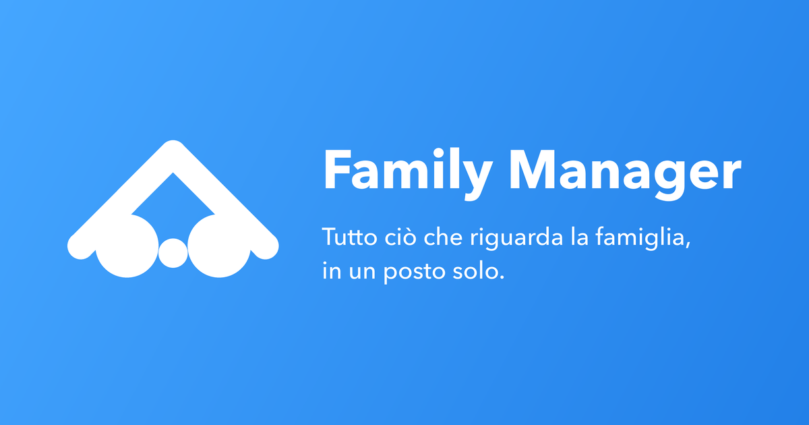

# Family Manager - app for families



The new Family Manager app, made for parents who are not technical. It will replace the Directus interface of the `family-manager-cms` repository, and it can be sold to other families: each family sees only its own data.

It is built with Laravel 13 from the Vue starter kit (Inertia, Vue 3, TypeScript, Tailwind 4, Fortify for sign-in, Wayfinder for the routes), and runs in Docker with Laravel Sail. The stage 1 prototype is gone: it can be recovered from the git history, commit `54a6702` (`git show 54a6702:prototype/…`).

The code is in English and the app speaks English and Italian: it takes the browser's language, and when it is neither of the two it uses `APP_LOCALE` (`it`). The Italian translations are in `lang/it.json` and `lang/it/`; how to add a text is in `AGENTS.md`.

## Starting the app

You need Docker. The first time:

```bash
cp .env.example .env
docker run --rm -v "$PWD":/app -w /app composer:2 composer install
./vendor/bin/sail up -d
./vendor/bin/sail artisan key:generate
./vendor/bin/sail artisan migrate --seed
./vendor/bin/sail npm install
```

The form fields come from FormKit Pro: its key goes in `VITE_FORMKIT_PRO_KEY` in `.env` before `npm run dev` or `npm run build`.

For the document previews the app uses `pdftoppm` (`poppler-utils`), `heif-convert` (`libheif-examples`) and PHP's `ext-gd` extension. The Sail image (`docker/8.5/`, Ubuntu 24.04, which adds `libheif-plugin-libde265` to read HEIC files) and `nixpacks.toml` (Ubuntu 22.04, where that decoder is already in `libheif1`) install them, so there is nothing to add. If a preview does not show up locally after an update, rebuild the image with `./vendor/bin/sail build --no-cache`.

Then, every time:

```bash
./vendor/bin/sail up -d
./vendor/bin/sail npm run dev
```

The app is on http://localhost:8090, the emails it sends on Mailpit, http://localhost:8025.

### The scheduler

Some work runs on Laravel's scheduler (`routes/console.php`): `loans:refresh`, every night at 00:05 Europe/Rome time. Locally it runs only while the scheduler is on:

```bash
./vendor/bin/sail artisan schedule:work   # keeps it running, every minute
./vendor/bin/sail artisan schedule:run    # once, now
./vendor/bin/sail artisan schedule:list   # what is scheduled, and when
```

Online, Coolify needs a scheduled task that runs `php artisan schedule:run` every minute: without it `loans:refresh` never runs.

## Test accounts

The seeder creates the Bianchi family from the design board. The password is `password` for every account:

| Account | Who | Level |
| --- | --- | --- |
| `marco.bianchi@example.com` | Marco Bianchi | Everything |
| `laura.bianchi@example.com` | Laura Bianchi | Everything |

Giulia, the daughter, has no account.

## Commands

The full list of commands, with the code rules, is in `AGENTS.md`. The most used:

| Command | What it does |
| --- | --- |
| `./vendor/bin/sail test` | PHP tests |
| `./vendor/bin/sail npm run test` | Frontend tests |
| `./vendor/bin/sail npm run build` | Frontend build |
| `./vendor/bin/sail artisan migrate:fresh --seed` | Rebuilds the database with the Bianchi family |
| `./vendor/bin/sail artisan directus:copy --family="Leica"` | Copies a family from Directus |
| `./vendor/bin/sail artisan loans:refresh` | Works out again the instalments paid of the active loans of every family (the scheduler runs it every night) |

## Cards

The cards of a family (home, utilities, vehicles, insurance policies, loans and the others) are described in `app/Cards/`: one class per type in `app/Cards/Types/`, listed in `CardTypes`, with its area, fields, conditions and dates. Rules, saving, rows and the form of the pages all come from that description, so a new field of a card is added there (and in the migration, if the column is new), with its case in `tests/Unit/Cards/CardTypesTest.php`.

## Budget

*Budget* has three tabs: *Movements* (the expenses and incomes of a month), *Planned and spent* (the due dates of the month against what was spent, by category, and the last six months) and *Planned expenses* (the expenses and incomes that repeat). The due dates are not stored: `App\Services\Occurrences` works them out from each planned expense or income and its exceptions, and `App\Services\Deadlines` joins them to the payments. A payment says which due date it settles in `occurrence_date` on `expenses` and `incomes`. *I paid it* (`RecordPayment`) and *Change this due date* (`ChangeOccurrence`) start from a due date; the cards show their own payments (`CardBudgets`). A loan works out its last instalment, total, cost and instalments paid by itself (`LoanSchedule`, `LoanObserver`), when it is saved and every night with `loans:refresh`. Rules and decisions are in the *Bilancio* note of the vault (`02 - Documentazione tecnica/App Laravel/`).

A family copied from Directus before the `occurrence_date` migration has payments without their due date, so its due dates look late: copy it again with `directus:copy --replace`, which fills them.

## Copy from Directus

`directus:copy --family="<name>"` copies the family stored in Directus into the app: people, organizations, records, documents with their files and links, reminders, and the people's accounts (with their Directus email and a new password, chosen through *Forgot password*), and it gives each copied payment the due date it settles (`occurrence_date`). Directus is read only: the `directus` connection takes the `DIRECTUS_DB_*` variables from `.env`, and the Directus files folder is mounted read only from `DIRECTUS_UPLOADS_SOURCE` (by default `../family-manager-cms/uploads`). If the family is already there the command stops; `--replace` deletes it with its files and copies it again, but only if it was copied from Directus (a family with the same name that signed up in the app is never touched), and `--without-files` does not copy the content of the files. What is copied and what is not is in the *Copia da Directus* note of the vault (`02 - Documentazione tecnica/App Laravel/`).

## Documentation

Analysis, plan and decisions are in the project's Obsidian vault, ToDo items *Nuova app per le famiglie in Laravel*, *Nuova app - base dell'app*, *Nuova app - le pagine delle schede* and *Nuova app - bilancio e pagamenti*. The approved screens are on the Claude Design board *Family Manager - app per le famiglie*.
